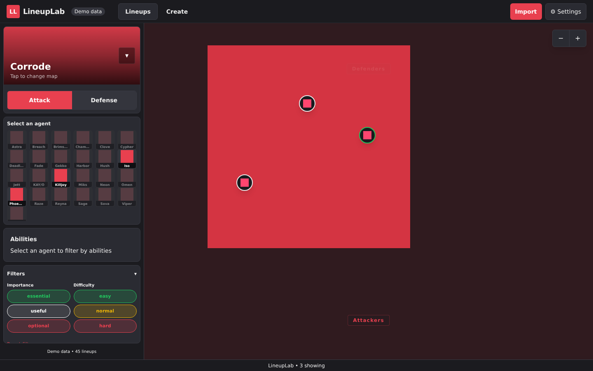

# LineupLab

Valorant lineups browser styled like OP.GG — now with **pack import** and **create wizard** (skeleton). Built with **Tauri 2 + React + TypeScript + Vite + Tailwind**, one codebase for Windows & Android.



> v0.2.0 — no-scroll 100dvh shell, IndexedDB repository, pack import (.zip), annotated detail with zoom lens.

## Features (v0.2.0)

- **Map picker** (splash + dropdown tile grid), Attack/Defense toggle
- **Agent grid** (ResizeObserver 6→7 cols, dims agents without lineups for map/side)
- **Ability toggles** (multi-select per agent)
- **Importance/Difficulty** pills (all selected by default), collapsible Filters card
- **Minimap** zoom (+/−, wheel `passive:false`, drag, pinch, double-click reset), markers (ring = importance), hover path + tooltip, detail panel
- **No-scroll shell**: `html,body,#root {height:100%;overflow:hidden;overscroll-behavior:none}` + `#root {height:100dvh;display:flex;flex-direction:column}`. Document never scrolls at 1100×650/390×640; left panel fits with thin scrollbar last resort; map wheel/pinch isolated (`touch-action:none`), overlays `max-height:calc(100dvh-2rem)` internal scroll, Android bottom sheet.
- **Pack import**: .zip `manifest.json` + `lineups/*.json` + `media/asset_*.jpg|.mp4`, tolerant `zod`, safe unzip (no traversal, 100MB/2000 files limits), mapping `attributes`/`projectiles`/`steps`/`media` → `slots{stand1,aim1,stand2,aim2,landing}`/`throws[]`/`steps`/`attributes`/`circles` (deduped by id), IndexedDB via `idb` SHA-256 dedup never re-encode + thumbnails, conflict Skip/Overwrite/Copy, preview dialog (chips New/Identical/Pack newer/Local newer/Error, `isSeedPlaceholder` unchecked), progress + report + Undo + history.
- **Annotated detail**: `AnnotatedImage` SVG circles + zoom lens (clamped + connector, hidden <200px)
- **Create wizard** (UI skeleton): tab next to Lineups, 5-step clickable stepper (Setup/Capture/Pins/Details/Review), 40/48px controls, mock "Coming soon" toasts, fits viewport.

## Tech

- State: Zustand + localStorage `lineuplab_prefs_v1`; data: IndexedDB `lineuplab` (idb) `lineups`/`media`/`importHistory`
- Valorant API (agents/maps/version) with fallback snapshots `src/data/fallback*.json`
- CSP: `img-src asset: https://tauri.localhost https://media.valorant-api.com data: blob:` etc — fixes Tauri `fetch("/lineups.json")` on `https://tauri.localhost`
- Rust: `main.rs` hides console (`windows_subsystem="windows"` in release)

## Dev setup

```bash
npm install
npm run dev       # http://localhost:5173
npm run build     # tsc + vite build → dist/ (377kB)
npm run test      # vitest
npm run generate-demo  # regenerate public/lineups.json
npm run screenshots    # Playwright/Chromium screenshots via @sparticuz/chromium
```

Prerequisites: Node 20, Rust 1.77+ for Tauri.

## Build (native)

```bash
npm run tauri build                # Windows NSIS .exe
npm run tauri android build -- --apk
```

See `docs/RELEASING.md` and `docs/WINDOWS_TEST_PLAN.md`.

## Pack format

See `docs/PACK_FORMAT.md`. Quick create:

```bash
node scripts/create-sample-pack.mjs  # writes sample-pack.zip
# then in app: Import → choose .zip
```

## Screenshots

Generated via `scripts/take-screenshots-fixed.mjs` + `scripts/generate-screenshots-v2.mjs` with @sparticuz/chromium (al2023 libs):

- `desktop-default.png` / `desktop-agent-selected.png` / `desktop-hover.png` / `desktop-detail.png` (1440×900)
- `desktop-filters-deselected.png` / `desktop-map-dropdown.png`
- `desktop-import-preview.png` / `desktop-import-progress.png` / `desktop-import-report.png`
- `desktop-create-setup.png` … `desktop-create-review.png` (5 steps)
- `desktop-settings.png`
- `mobile-390.png` (390×844) + `mobile-390-*.png` variants
- `loading.png` / `empty.png`

## Project structure

```
src/
  components/ ValImage, TopBar, MapCard, AgentGridCompact, AbilityBar, FiltersCardCollapsible, Minimap, DetailPanel, AnnotatedImage, ImportDialog, CreateWizard
  lib/ valorantApi, filtering, db (idb), indexedDBRepository, packImporter (zod/fflate)
  stores/ appStore
  hooks/ useValorantData
  types/ lineup (extended v0.2.0)
  data/ fallbackAgents/Maps/Lineups.json
src-tauri/ Tauri config + icons + gen/android
scripts/ generate-demo.ts, take-screenshots*.mjs, create-sample-pack.mjs
docs/ PACK_FORMAT.md, WINDOWS_TEST_PLAN.md, RELEASING.md, screenshots/
tests/ filtering.test.ts, valImage.test.tsx, no-scroll.spec.ts
```

## What works / next

- **Works:** browse, filters, minimap, import, detail lens, create skeleton, no-scroll, offline fallback.
- **Untested on Linux:** real Windows NSIS built on `windows-latest` GH Actions; SmartScreen unsigned warning expected.
- **Next:** real Create capture (file input + IndexedDB), cloud sync, overlay.

## License

MIT
